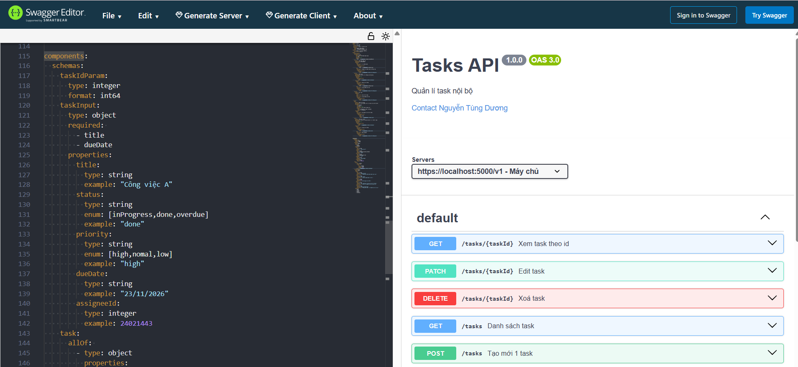
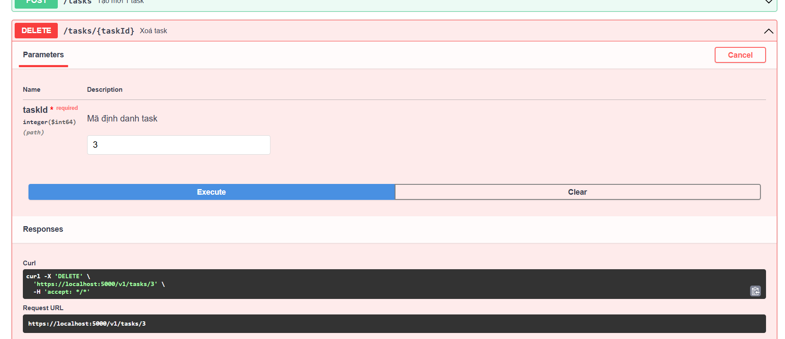

- Swagger UI

- Try it out

# 2 quyết định thiết kế khó nhất
- Viết schema cho patch và input của request body. Bản chất 2 cái này khá tương đồng chỉ khác thường request body thường bắt buộc 1 số trường còn patch thì ko yêu cầu
- Thiết kế schema cho lỗi NotFoundErrorResponse tuân theo chuẩn Problem Details RFC 7807, nhưng về cấu trúc thì các lỗi khác cũng có schema tương tự, nếu dùng chung thì không nhất quán, mà nếu tạo  riêng thì bị trùng lặp 